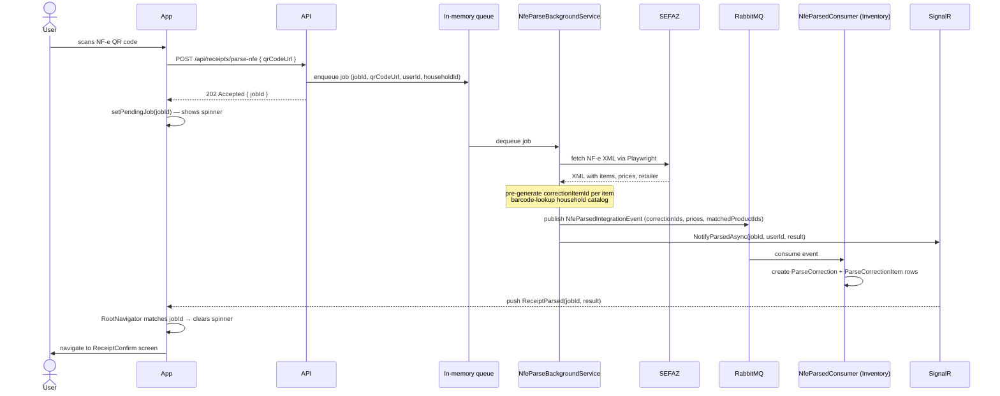
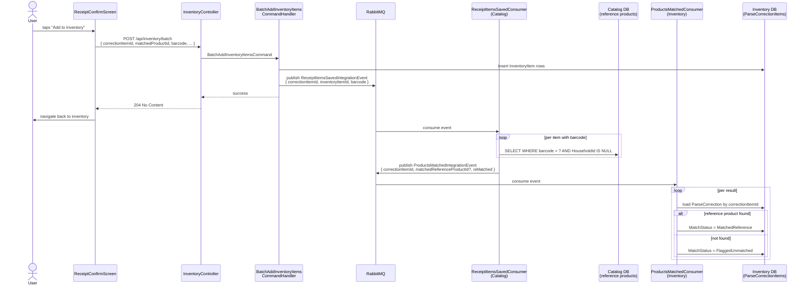
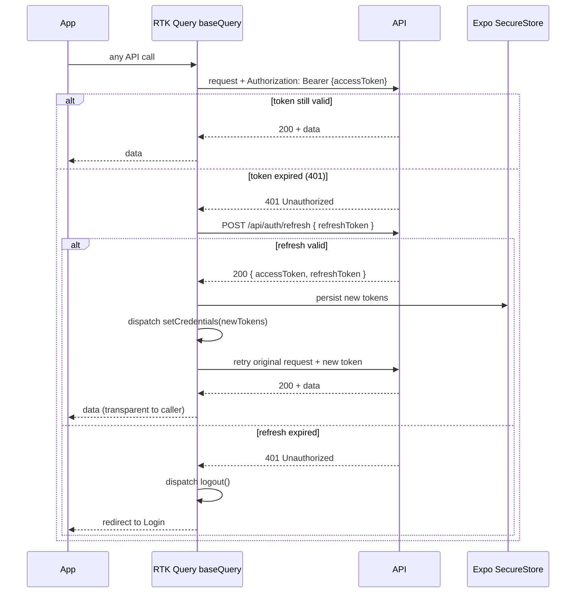

# Stoq

Smart inventory and grocery manager. Scan NF-e QR codes or receipt photos to populate your household inventory automatically.

**Stack:** .NET 10 modular monolith · React Native (Expo) · PostgreSQL · RabbitMQ (MassTransit 8) · SignalR

---

## Key flows

### 1. NF-e QR code scan (async, real-time push)

Parsing a Brazilian NF-e receipt is slow — it requires fetching XML from a government endpoint (SEFAZ). The request is accepted immediately and the result is pushed to the app over WebSocket when ready.



**Why pre-generate the IDs in the background service?**
The SignalR push and the MassTransit consumer run concurrently and independently. By generating `correctionItemId` GUIDs before publishing the event, both paths agree on the same IDs without coordinating — the mobile receives them in the push, and the database rows are created with the exact same values by the consumer.

**What if the user navigates away before the result arrives?**
`ReceiptScanScreen` stores `jobId` in Redux (`receiptSlice`). When the screen unmounts, it dispatches `setPendingJob(null)`. The handler in `RootNavigator` checks `jobId === pendingJobIdRef.current` — if the user has already left, this is `null` and the result is silently dropped. The user would need to scan again.

---

### 2. Background product matching pipeline

After the user confirms the receipt items and they are added to inventory, the system silently tries to match each item against the global reference product catalog (by barcode). This enriches the `ParseCorrectionItem` records for backoffice analytics — the user never sees it.



**`MatchStatus` lifecycle for a single item:**

| Moment | Status |
|---|---|
| NF-e parsed, item's barcode found in household catalog | `MatchedHousehold` |
| NF-e parsed, barcode not in household catalog | `Pending` |
| Step 2 consumer finds a global reference product | `MatchedReference` |
| Step 2 consumer finds no reference product | `FlaggedUnmatched` |

`FlaggedUnmatched` is the backoffice signal: a barcode that arrived from a real receipt but has no entry in the global catalog. An admin can query these to grow the reference database.

---

### 3. JWT authentication and silent token refresh

Access tokens are short-lived (15 min). The RTK Query base query intercepts every 401 and transparently refreshes before retrying — the user never sees a login prompt mid-session.



Tokens are never stored in AsyncStorage. The access token lives in Redux memory; the refresh token lives in Expo SecureStore (device keychain). On cold start, the app reads the refresh token from SecureStore and exchanges it for a new access token before rendering any screen.

---

## One-time setup

1. Set AppHost user secrets (run from the repo root):

```bash
dotnet user-secrets set "Parameters:postgres-password" "postgres" --project server/Stoq.AppHost
dotnet user-secrets set "Parameters:rabbitmq-password" "guest" --project server/Stoq.AppHost
```

These match the credentials already in your `appsettings.Development.json`, so no changes are needed there.

2. Start AppHost once to recreate the containers with the new persistent configuration:

```bash
dotnet run --project server/Stoq.AppHost
```

Wait for everything to go healthy in the Aspire dashboard, then stop it with `Ctrl+C`. The containers keep running in Docker after AppHost exits.

## Day-to-day VS debugging

1. Open the solution in Visual Studio.
2. Set `Stoq.ApiService` as the startup project.
3. Press `F5` — it reads `appsettings.Development.json`, connects to the already running containers, applies EF migrations, and starts.

No Aspire is needed for daily debugging. The containers also survive reboots, as Docker Desktop auto-restarts them on login.

If the containers happen to be stopped, for example after a Docker Desktop restart with auto-start off, run:

```bash
docker start stoq-postgres stoq-rabbitmq
```

## Using Aspire again

To use full Aspire orchestration again, including dashboard, health checks, and log streaming, just start AppHost. It detects the existing persistent containers and reuses them.
