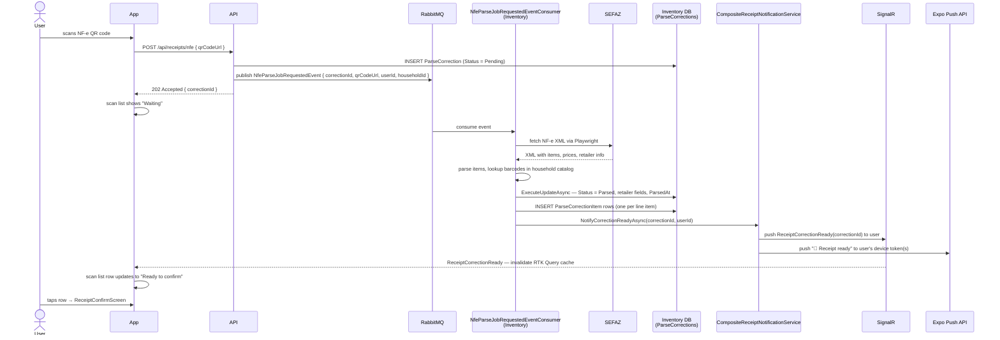
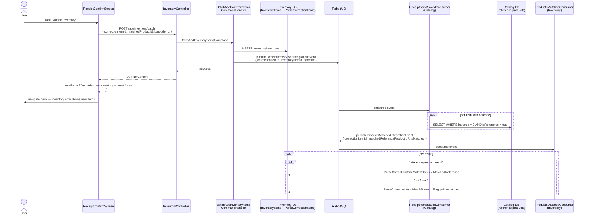
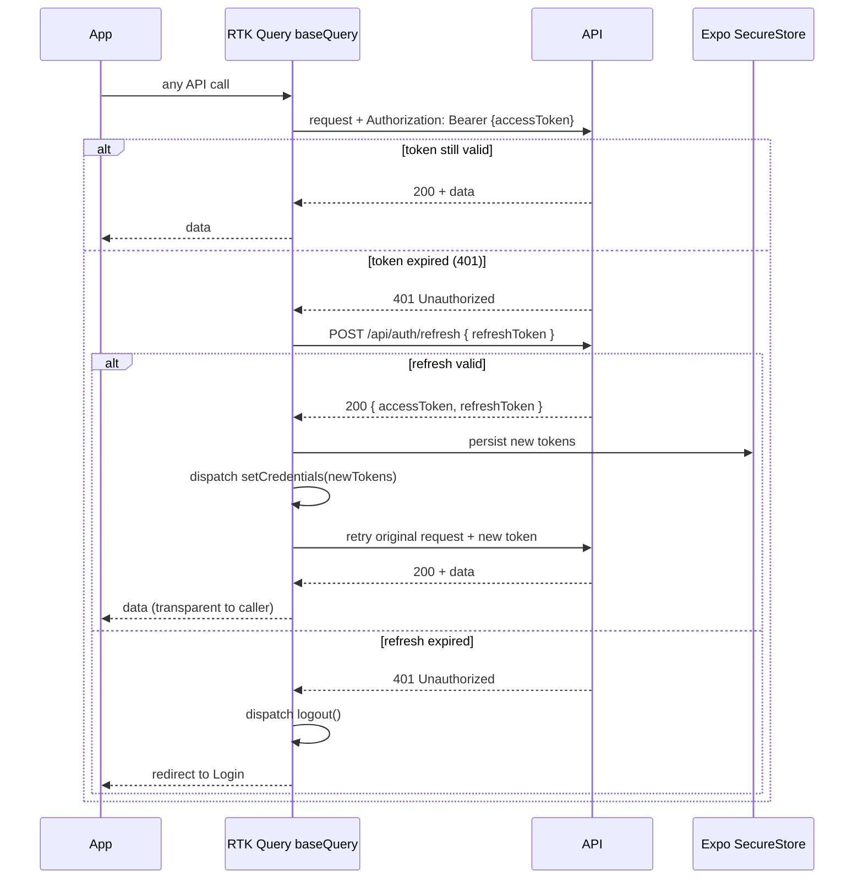

# Stoq

Smart inventory and grocery manager. Scan NF-e QR codes or receipt photos to populate your household inventory automatically.

**Stack:** .NET 10 modular monolith · React Native (Expo) · PostgreSQL · RabbitMQ (MassTransit 8) · SignalR

---

## Key flows

### 1. NF-e QR code scan (async, real-time push)

Parsing a Brazilian NF-e receipt is slow — it requires fetching XML from a government endpoint (SEFAZ) via Playwright. The request is accepted immediately; the result is delivered to the app over SignalR (foreground) or push notification (background) when ready.



**What if parsing fails?**
`NfeParseJobFaultConsumer` (MassTransit fault pipeline) catches unhandled exceptions, sets `Status = Failed` on the `ParseCorrection` record, and calls `NotifyCorrectionFailedAsync` — which sends both a SignalR event and a push notification. The scan list row shows "Failed".

**What if the app is backgrounded when the result arrives?**
`CompositeReceiptNotificationService` sends a push notification via the Expo Push API in addition to the SignalR event. Tapping the push notification deep-links the user directly to the Scan List screen.

---

### 2. Background product matching pipeline

After the user confirms the receipt items and they are added to inventory, the system silently tries to match each item against the global reference product catalog (by barcode). This enriches the `ParseCorrectionItem` records for backoffice analytics — the user never sees it.



**`MatchStatus` lifecycle for a single item:**

| Moment | Status |
|---|---|
| NF-e parsed, item's barcode found in household catalog | `MatchedHousehold` |
| NF-e parsed, barcode not in household catalog | `Pending` |
| Matching pipeline finds a global reference product | `MatchedReference` |
| Matching pipeline finds no reference product | `FlaggedUnmatched` |

`FlaggedUnmatched` is the backoffice signal: a barcode that arrived from a real receipt but has no entry in the global catalog. An admin can query these to grow the reference database.

**Why does inventory appear immediately after confirm?**
`InventoryDashboardScreen` uses `useFocusEffect` to call `refetch()` every time the screen gains focus. Since `POST /api/inventory/batch` inserts rows synchronously before returning 204, the items are in the database by the time the user lands back on the inventory screen.

---

### 3. Push notification pipeline

Three server-side events trigger push notifications to household members via the Expo Push API.

| Trigger | Recipient(s) | Deep link |
|---|---|---|
| Daily expiry scan — item expiring in 1 or 3 days | All household members | Inventory → Expiry Alerts |
| Daily low-stock scan — product total ≤ min quantity | All household members | Shopping List |
| Shopping list item added by a member | All other household members | Shopping List |
| Receipt parsing complete (foreground fallback) | User who scanned | Scan List |
| Receipt parsing failed (foreground fallback) | User who scanned | Scan List |

**Daily scans** are driven by `ExpiryCheckBackgroundService` (runs every 24 h). It calls `ExpiryCheckService` and `LowStockCheckService` in sequence. Each service queries the current state across all households and publishes one integration event per household to RabbitMQ. The `ItemExpiringAlertIntegrationEventConsumer` and `LowStockDigestIntegrationEventConsumer` in the Identity module consume those events, look up device tokens, and call `IExpoPushService`.

**Shopping list updates** are published by `AddShoppingListItemCommandHandler` immediately after `SaveChangesAsync`. `ShoppingListUpdatedIntegrationEventConsumer` skips the initiating user so they don't receive a notification for their own action.

**Receipt notifications** use `CompositeReceiptNotificationService` — it sends both a SignalR event (instant, if the app is open) and a push notification (fallback if the app is backgrounded) for the same outcome.

**Device token lifecycle:**
- Registered on first app launch after login via `POST /api/notifications/token`.
- Refreshed on every subsequent login (upserted by `ExpiryDate = token`).
- Removed on logout via `DELETE /api/notifications/token` so stale tokens do not linger.

---

### 4. JWT authentication and silent token refresh

Access tokens are short-lived (15 min). The RTK Query base query intercepts every 401 and transparently refreshes before retrying — the user never sees a login prompt mid-session.



Tokens are never stored in AsyncStorage. The access token lives in Redux memory; the refresh token lives in Expo SecureStore (device keychain). On cold start, the app reads the refresh token from SecureStore and exchanges it for a new access token before rendering any screen.

---

## One-time setup

1. Set AppHost user secrets (run from the repo root):

```bash
dotnet user-secrets set "Parameters:postgres-password" "postgres" --project server/Stoq.AppHost
dotnet user-secrets set "Parameters:rabbitmq-password" "guest" --project server/Stoq.AppHost
```

These match the credentials already in your `appsettings.Development.json`, so no changes are needed there.

2. Start AppHost once to recreate the containers with the new persistent configuration:

```bash
dotnet run --project server/Stoq.AppHost
```

Wait for everything to go healthy in the Aspire dashboard, then stop it with `Ctrl+C`. The containers keep running in Docker after AppHost exits.

## Day-to-day VS debugging

1. Open the solution in Visual Studio.
2. Set `Stoq.ApiService` as the startup project.
3. Press `F5` — it reads `appsettings.Development.json`, connects to the already running containers, applies EF migrations, and starts.

No Aspire is needed for daily debugging. The containers also survive reboots, as Docker Desktop auto-restarts them on login.

If the containers happen to be stopped, for example after a Docker Desktop restart with auto-start off, run:

```bash
docker start stoq-postgres stoq-rabbitmq
```

## Using Aspire again

To use full Aspire orchestration again, including dashboard, health checks, and log streaming, just start AppHost. It detects the existing persistent containers and reuses them.
